

  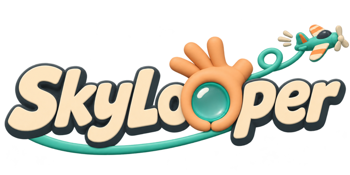

  <b>Loop a tiny toy plane through rings you make with your own hands.</b> 
  A seated mixed-reality game for <b>Meta Quest 3 and 3S</b>. Hands only, no controllers.

  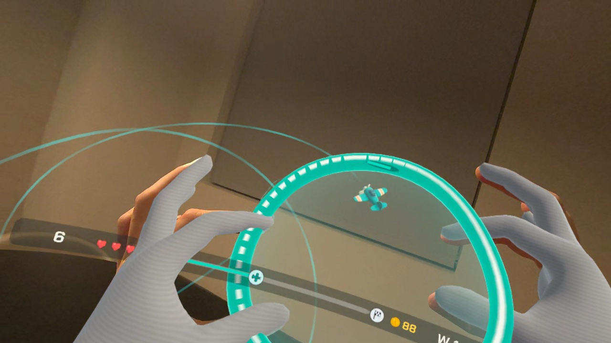

A little propeller plane takes off in your room and flies a twisting route through the space in front of
you. Curl your finger and thumb into a **C**, and a bubble ring grows inside your hand. Hold it where the
plane is heading and score as it loops through. Keep your hands out of its way, though: to the plane, your
hands are solid rock.

Every flight is a new route. Fighters chase it, bombers drop explosive balloons, floating islands drift
into its path, and every fifth wave a giant zeppelin turns up and won't leave.

## How to play

<table>
  <tr>
    <td width="50%">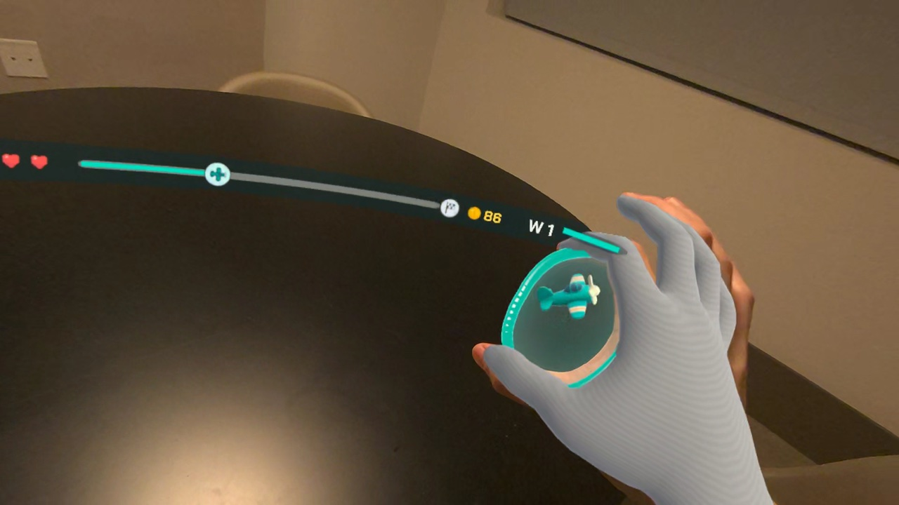</td>
    <td width="50%">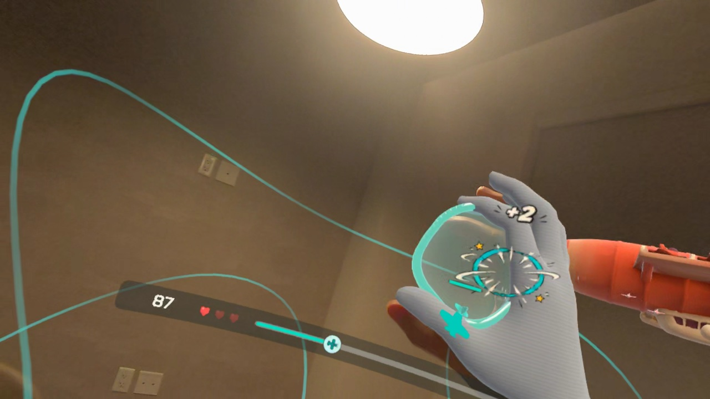</td>
  </tr>
  <tr>
    <td><b>Make a C.</b> Curl your index finger and thumb and a bubble ring fills in, following the shape of your fingers.</td>
    <td><b>Catch the plane.</b> It scores flying through from either side. Bring both hands together for one big, easier <b>O</b> ring.</td>
  </tr>
</table>

- **Follow the line.** A faint trail shows where the plane is going. In later levels it fades after
  take-off; land 3 rings in a row to bring it back.
- **Don't touch the plane.** Your hands count as solid. A bump costs a hit, and enough hits cost a life.
- **Pause** by turning a palm toward you and tapping the **Menu** button on that wrist.

## Fight back

<table>
  <tr>
    <td width="50%">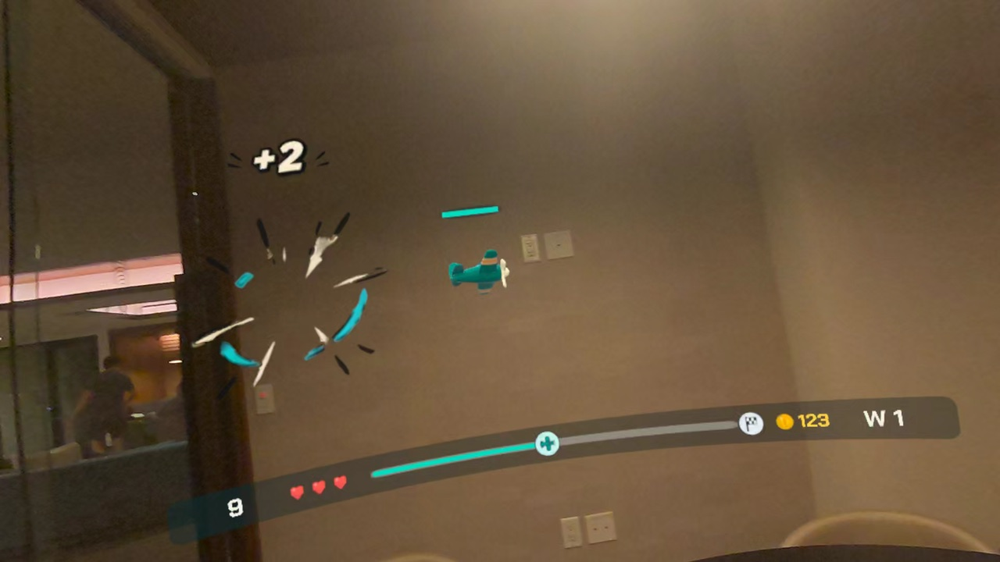</td>
    <td width="50%">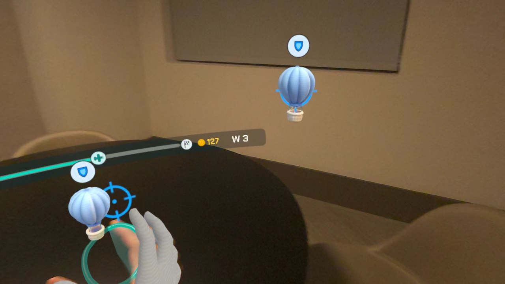</td>
  </tr>
  <tr>
    <td><b>Flick fighters out of the sky</b> and block their bullets with your hands. Cup a bomber's flashing bomb balloon in your hands until it's contained.</td>
    <td><b>Grab powerups.</b> Pinch a balloon's crosshair and drag it onto the path. Blue gives a one-hit shield; gold fits an auto-turret for a few seconds.</td>
  </tr>
  <tr>
    <td>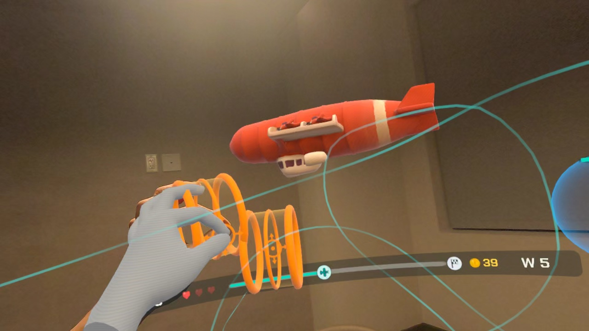</td>
    <td>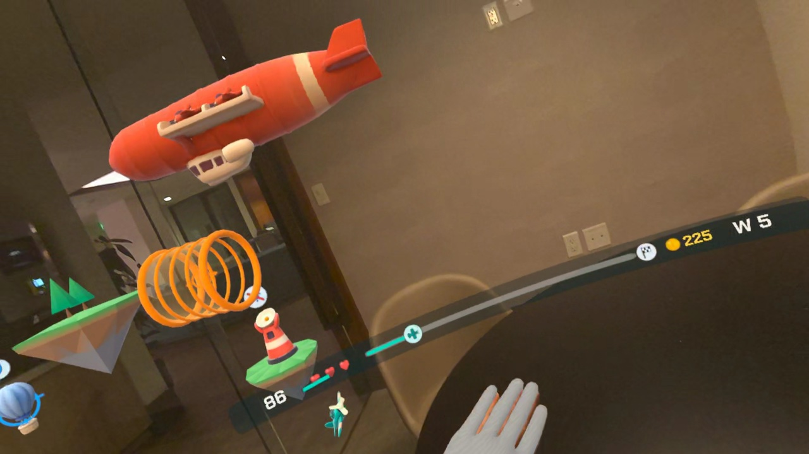</td>
  </tr>
  <tr>
    <td><b>Booster tubes.</b> Pick one up and it moves like a real object. Line it up where the path goes, and a clean pass through gives the plane a speed boost.</td>
    <td><b>Floating islands</b> drift around the path, and the plane crashes into them. Some carry <b>jamming towers</b> that silence your enemy warnings.</td>
  </tr>
</table>

  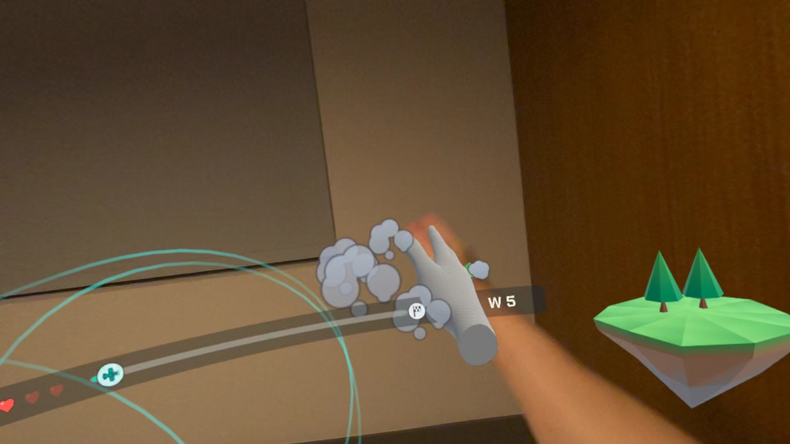 
  Smack an island to shatter it, but watch where the shards drift.

## The zeppelin

<table>
  <tr>
    <td width="50%">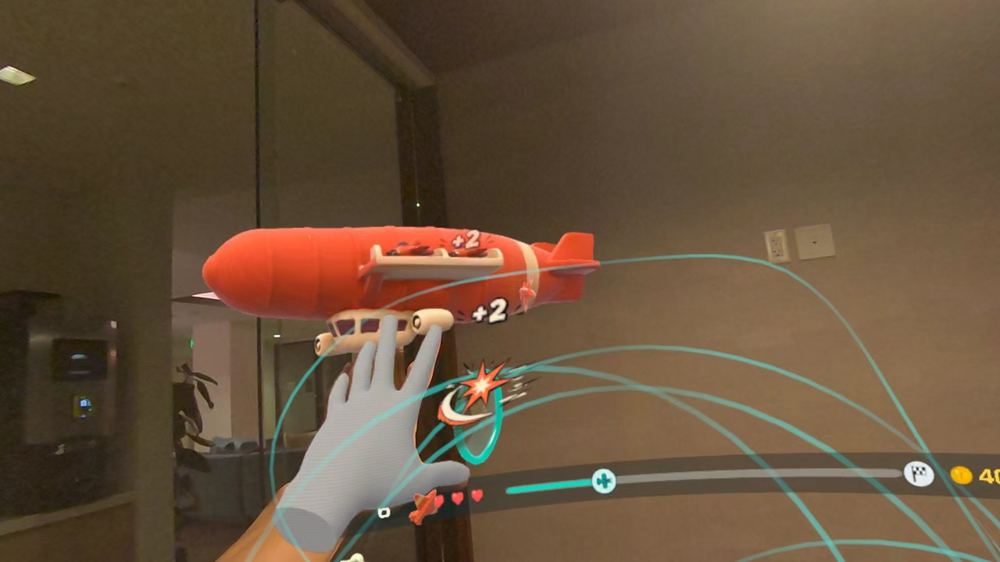</td>
    <td width="50%">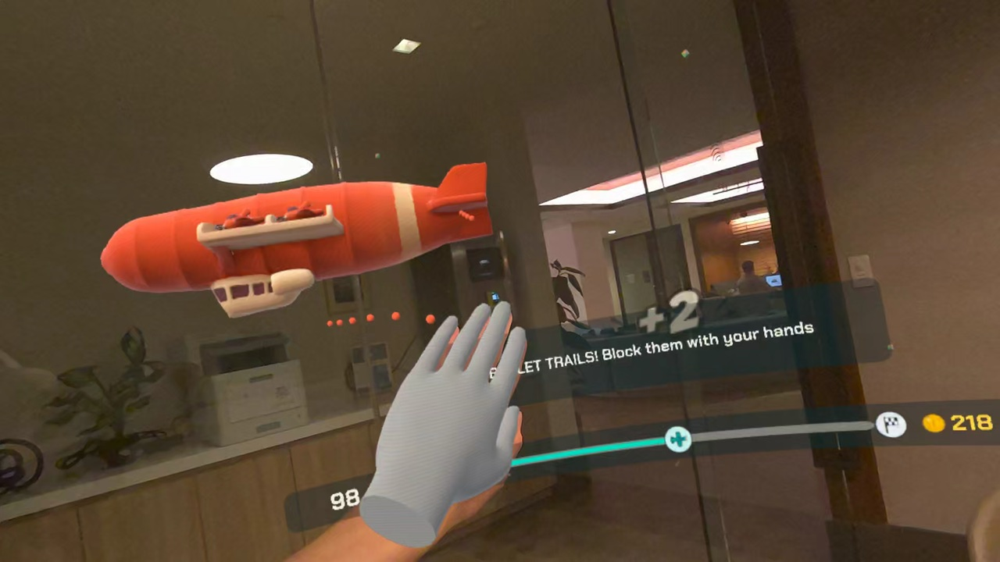</td>
  </tr>
</table>

Every fifth wave of Infinite is a boss wave. A giant zeppelin cruises around your play space and can't be
destroyed, so you just have to survive it. It fires **bullet trails** at your plane (block them with your
hands), launches **fighters** from its decks, and lobs big **tracking missiles**. Hold a missile in an open
palm until it drops out of the sky, or smack it to set it off, but only when it's far from the plane.

## Modes

- **Tutorial**: six short levels, each introducing one idea: rings, reacting on the fly, fuel, fighters,
  powerups and bombers. Passing them all unlocks the rest.
- **Infinite**: endless waves that slowly ramp up, with islands, towers and zeppelin boss waves.
  Chase your high score and earn coins as you go.
- **Zeppelin**: a bonus level to practise against the boss with every attack it has.
- **Hangar**: spend your Infinite coins on new planes and paint. Each plane comes with its own perks.

  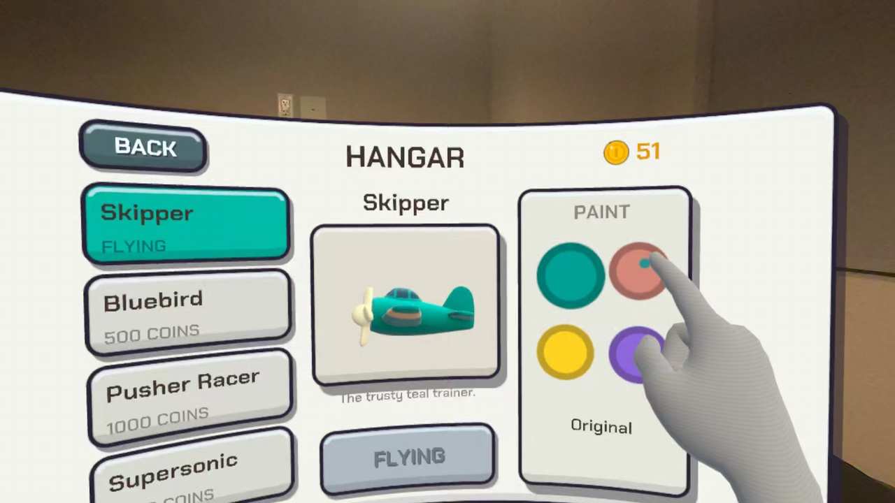

| Plane | Cost | Perk |
|---|---|---|
| Skipper | Free | The original |
| Bluebird | 500 | Fits a turret when each wave's first enemy shows up |
| Pusher Racer | 1000 | Boosts for 3 seconds at the start of every wave |
| Supersonic | 2000 | Twin turrets, plus a boost at every wave start |

## Custom Paths

Draw your own level in the air around you, then fly it.

<table>
  <tr>
    <td width="50%">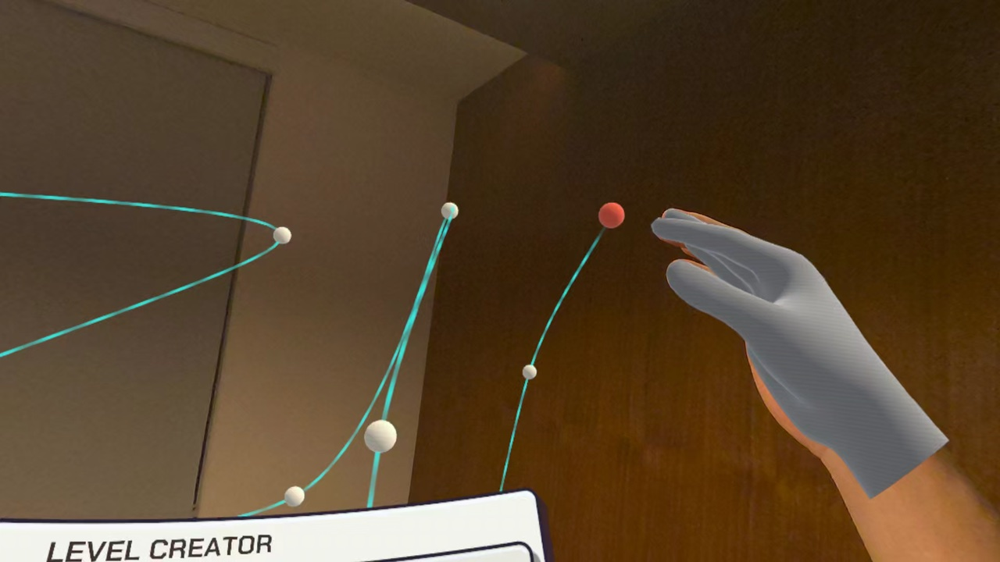</td>
    <td width="50%">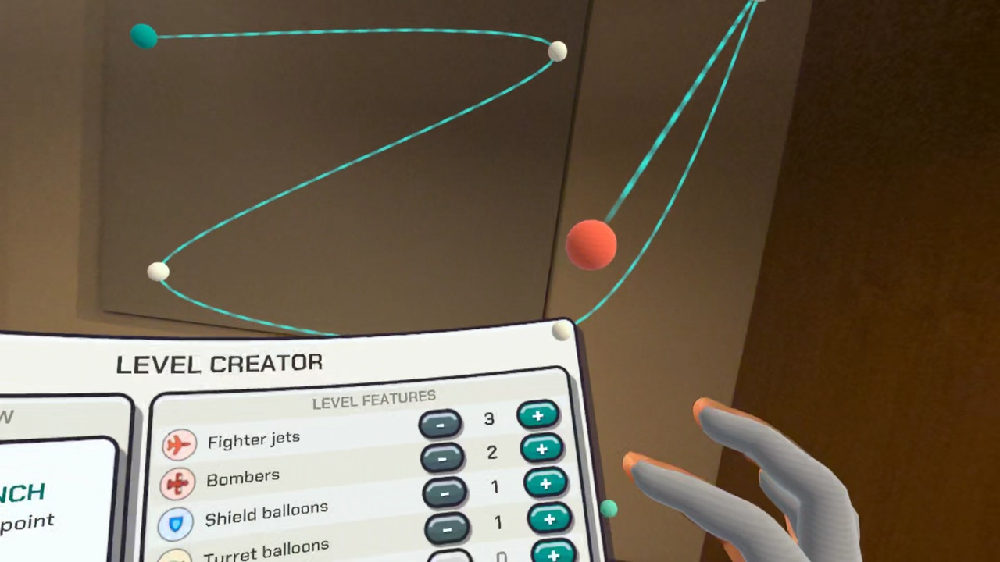</td>
  </tr>
  <tr>
    <td><b>Pinch to draw.</b> A right-hand pinch drops a point where your fingers meet, and the points join into a smooth path. A left-hand pinch on a point removes it.</td>
    <td><b>Set it up.</b> Choose how many fighters, bombers, balloons, booster tubes and islands show up, whether the plane burns fuel, and whether the path stays visible or fades.</td>
  </tr>
</table>

  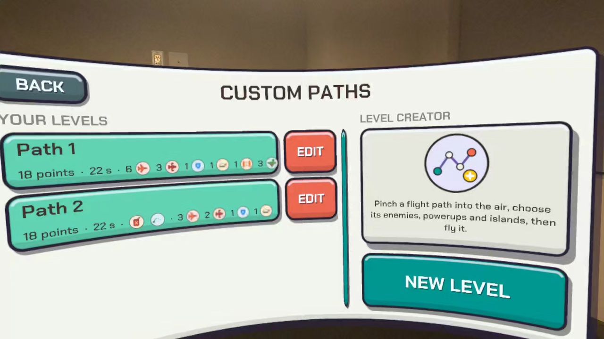 
  Your levels are saved on the headset. Fly them again any time, or edit them.

## Scoring

| Move | Points |
|---|---|
| Plane through a one-hand C ring | 2 |
| Plane through the big two-hand O ring | 1 |
| Flicking a fighter out of the sky | 2 |
| Flicking a bomber out of the sky | 4 |
| Holding a zeppelin missile until it drops | 2 |
| Your turret shooting an enemy down | 1 |

In Infinite you also earn coins for scoring, containing bomb balloons and surviving each wave. Each
tutorial level pays a coin bonus the first time you pass it.

## Install

SkyLooper isn't on the Meta Horizon Store. You install it yourself ("sideloading").

1. Turn on **Developer Mode** for your headset in the Meta Horizon phone app.
2. Download `SkyLooper.apk` from the [Releases](https://github.com/CecilBoeyGit/SkyLooper/releases) page.
3. Install it with [SideQuest](https://sidequestvr.com/), or plug in the headset and run
   `adb install -r SkyLooper.apk`.
4. On the headset, find **SkyLooper** in your app library under **Unknown Sources**.

**You'll need:**
- A Meta Quest 3 or 3S with **hand tracking** turned on. Controllers aren't used.
- A chair and a clear space in front of you, about an arm's reach in every direction.
- Passthrough. You play in your own room.

## Credits

Made by Cecil Boey with Unity, the Meta XR SDK and OpenXR. Most sound effects are from
[freesound.org](https://freesound.org) (sources in [`Tools/Audio/SOURCES.md`](Tools/Audio/SOURCES.md)), and the music is
synthesized. The font is Chakra Petch (SIL Open Font License).

Want to build or tweak it yourself? See the [developer notes](Docs/DEVELOPMENT.md).
